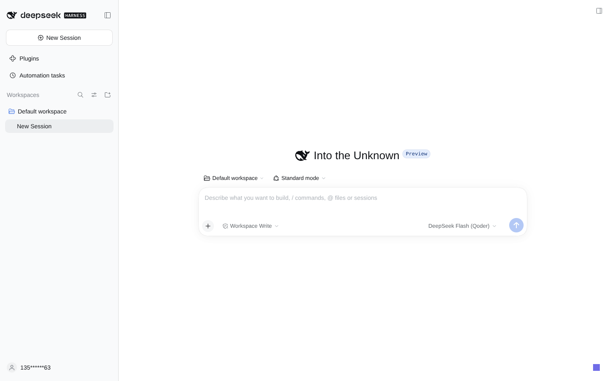
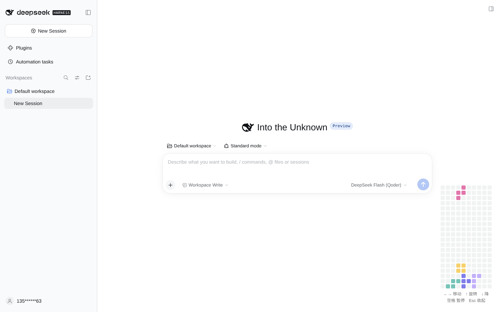
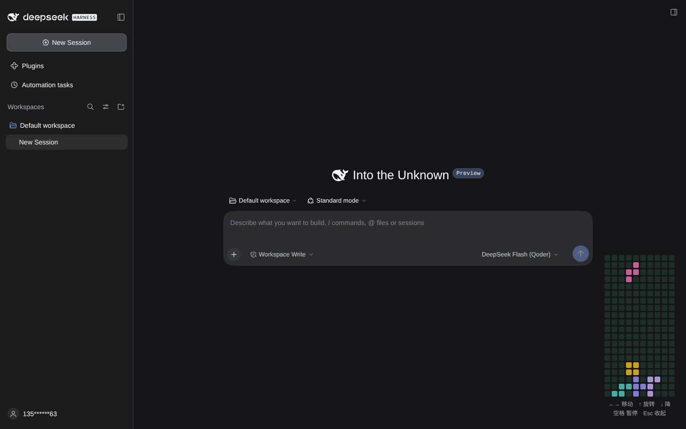
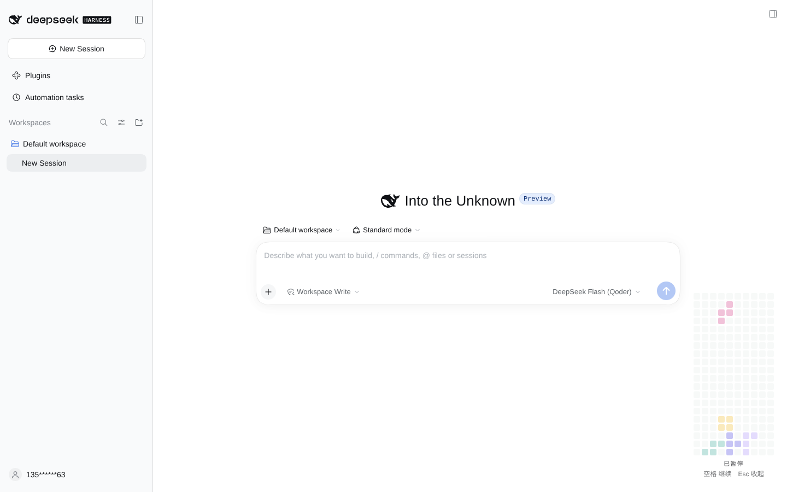
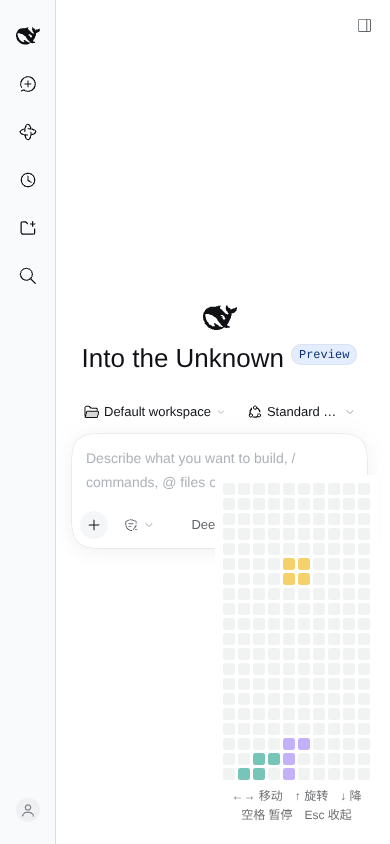

# dsh-plugin-tetris

一个装在 DeepSeek Harness Web GUI 右下角的**无计分俄罗斯方块**。平时只显示一个紫色小方块；点开后是一块贴合当前主题的紧凑棋盘，用键盘直接玩。





## 特性

- 10 × 20 标准棋盘，7 种方块，7-bag 随机。
- 无分数、无等级、无连击，只有最基础的堆叠和消行。
- 采用 Qoder `PixelBlocksGame` 的格子语言：每格之间是 **3px 透明缝**，格子本身只有 **2px 小圆角**；空格是 sage 底色，实块是 Qoder 调色板的 **80% 透明度**。
- 不画连续棋盘底、不画表格线、不画点阵、不加阴影；方块是平铺的独立小色块。
- 面板本身保持直角、纯色、无边框、无阴影。浅色主题下是白色，深色主题下是 `#151517`，避免透明面板和正文重叠。
- 没有游戏内按钮，也没有标题或角标；暂停/结束状态和操作提示都放在棋盘下方的一行小字里。
- 打开后键盘接管：方向键移动、旋转、软降；`空格` 暂停或继续。
- 面板失去焦点、窗口失焦或标签页隐藏时，自动收缩回小方块。
- 桌面端棋盘 `147 × 297`，面板约 `163 × 355`；右边距和底边距都是 16px，不再是一整页的留白。
- 纯客户端 React 插件，无额外运行时依赖，不需要构建步骤。

## 环境

- DeepSeek Harness `0.2.1-rc.2`（Web profile）实测通过。
- `dsh.hostMin`：`0.2.0-rc.1`。
- Node.js >= 22。

## 安装

在插件仓库目录执行：

```bash
dsh plugin --profile web add "$PWD"
```

然后在 DSH 的 **Plugins** 页面确认 `dsh-plugin-tetris` 及组件已启用。

> 安装或启用后，请重启一次 `dsh web`。Web 客户端 bundle 会在下次启动时进入 `__DSH_BOOT__` 清单；仅刷新页面不足以注册新的客户端插件。重启后右下角会出现方块入口。

也可以手动在 profile 的 `package.json` 里添加：

```json
{
  "dependencies": {
    "dsh-plugin-tetris": "link:/absolute/path/to/dsh-plugin-tetris"
  },
  "dsh": {
    "profile": {
      "bundles": ["dsh-plugin-tetris"]
    }
  }
}
```

## 操作

| 操作 | 键盘 |
| --- | --- |
| 左 / 右移动 | `←` / `→` |
| 旋转 | `↑` |
| 软降 | `↓` |
| 暂停 / 继续 | `Space` |
| 收起 | `Esc` |
| 游戏结束后重开 | `R` 或 `Enter` |

打开后焦点在棋盘上，按键只在棋盘获得焦点时生效；焦点移出面板、切换窗口或切到后台会自动收起，不会劫持聊天输入框。没有屏幕按钮，也不需要鼠标操作。

## 布局与适配

- 桌面端棋盘为 `147 × 297`（12px 格子 + 3px 缝），面板约 `163 × 357`；右边距 16px，底边距 16px。
- 字体提示为 12px，两行放完移动/旋转/软降/暂停/收起，不再额外占一行标题。
- 窄屏（`≤ 560px`）下边距收至 12px，棋盘宽度仍为 147px；高度超出视口时按高度等比缩小。
- 启动方块本身是 `16 × 16` 的纯色方块，外层 `32 × 32` 为点击区域。
- 棋盘空格色和实块色都来自 Qoder 的调色板；空格色通过 `--dsh-tetris-empty` 跟随 DSH 明暗主题。
- 暂停或结束时只把棋盘压暗，状态文字放在棋盘下方，不会用一块白色遮罩盖住半个棋盘。

浅色主题：


深色主题：



暂停状态：



手机尺寸：



## Qoder 参考

Qoder CN 的 Linux 版**不是开源软件**，官方没有公开仓库；但它是 Electron 应用，安装包里的 `resources/app.asar` 可以直接查看前端 bundle。我下载了官方 Linux 安装包并从中提取了首页小游戏模块 `PixelBlocksGame`（`out/renderer/assets/DzyA3kzr.js`，颜色常量在同目录的 `Cux9x6wn.js`）。

Qoder 的原始小游戏是一个横向的 **53 × 7** 条带，整体 `726 × 98`：

- 格子间距 `3px`，每个格子 `aspect-square`、`rounded-[2px]`。
- 空格使用 `bg-sage-bg`：浅色 `#f0f3f2`，深色 `#1c2e25`。
- 实块颜色统一加 `/80` 透明度。
- 外面没有卡片、边框、阴影或网格线，只有一格一格的色块。

它的调色板是：蓝 `#3f8ef7`、黄 `#f2c647`、紫 `#605ce5`、青 `#55b5a6`、粉 `#da5597`、薰衣草 `#b49ef9`、橙 `#ea873f`；深色主题对应 `#4ba8ff`、`#fac414`、`#9b96ff`、`#4dd4c4`、`#f472b6`、`#c9b5ff`、`#fa8125`。

本插件借用了它的**视觉语言**（3px 缝、2px 小圆角、sage 空格、80% 调色板、无外框），但保留你指定的 10 × 20 竖向棋盘和 `←→ / ↑ / ↓ / Space / Esc` 操作，没有改用 Qoder 的横向玩法。

参考安装包：<https://qoder-app.oss-cn-beijing.aliyuncs.com/qoder-app/releases/latest/Qoder-CN-linux-amd64.deb>

## 开发

仓库没有构建步骤，源码即产物：

```text
src/index.js          Host 侧占位插件（bundle 需要在 profile 中有一个宿主条目）
src/client.js         Web 客户端：游戏引擎 + Qoder 式小块 Canvas 棋盘 + 键盘面板
cordis.patch.yml      DSH bundle patch，插入 dsh-plugin-tetris 宿主条目
test/tetris.test.mjs  引擎与插件契约测试
docs/                 实机截图
```

运行检查：

```bash
npm test
npm run check
```

`npm run check` 会先做语法检查，再跑 9 个测试，覆盖包清单、`shell.overlay` 注册、方块形状/旋转、碰撞、消行、7-bag、生命周期和重开。

客户端通过以下方式接入：

```js
ctx.slots.inject('shell.overlay', () => ctx.slots.register({
  name: 'shell.overlay',
  id: 'dsh-plugin-tetris',
}, TetrisDock))
```

启动方块和棋盘都挂在根级 overlay 层，固定定位在右下角。棋盘通过 Canvas 直接绘制独立小色块；面板底色使用 DSH 的主题背景，不画可见边框。焦点离开后组件卸载，页面恢复成只有一个方块入口的状态。

## License

[MIT](LICENSE) © 2026 Liao Yuqiang
